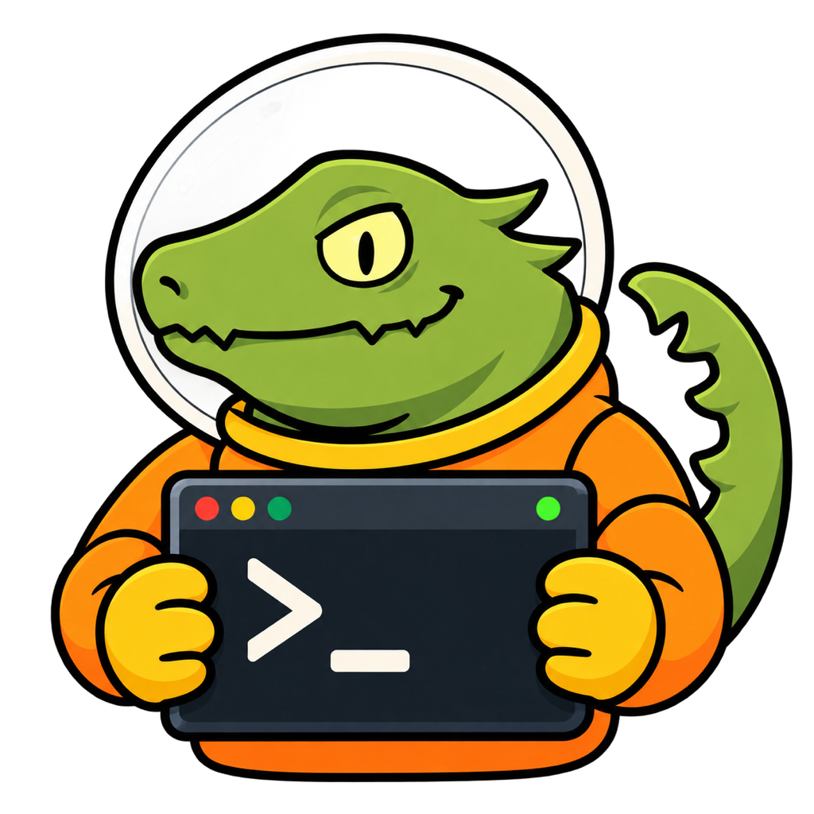

<p align="center">
  <a href="assets/macos/README.md"></a>
</p>

# ZeroWork

[English](README.md)

ZeroWork 是面向 Apple Silicon Mac 的 SSH 终端，架构定义见 [总体架构](docs/SPEC/OVERALL_ARCHITECTURE.md)。实现遵循 [V0.1.1→V0.1.8 设计路线图](docs/DESIGN/README.md)，每个版本先完成非 UI 工作，再进行 UI 集成。

## 当前基线

当前版本为 **0.2（插件宿主 API 2）**。**目前仅确认 Figma 原型已对齐 V3，App 尚未完成全部 V3 设计同步。** 详见 [当前脱敏基线](docs/DEVELOPMENT/V0.2_STATUS.md)。实现及兼容性边界记录在 [V0.2 实现说明](docs/DEVELOPMENT/V0.2_IMPLEMENTATION.md)中；候选版本的具体结果、真实 SSH/AI 验证证据及环境限制见 [V0.2 实机验收](docs/DEVELOPMENT/V0.2_LIVE_ACCEPTANCE.md)。

- 项目使用 Zig 0.17.0（本地通过 zvm 管理），目标固定为 arm64、macOS 14 或更新版本。
- P0 配置模型及严格子集 TOML 加载器。
- 配置采用原子替换，权限限制为仅所有者可读写（0600）。
- Sauber 渲染器设计令牌，包含浮层和 AI 状态颜色。
- Apple Silicon/macOS 平台契约。
- Ghostty `libghostty-vt` 是唯一的 VT 解析器，通过 Ghostty C ABI/渲染状态适配器接入；I/O 边界由 worker/kqueue 契约管理。

Zenit 是原生 macOS UI 层，使用已获授权的固定 GPL 修订版本；ZeroWork 不另建 Objective-C/Swift UI 桥接层。应用通过 Zenit `App.runWith` 启动，全部正式 UI 均通过 Zenit 公共 API 构建。历史上独立的单 CAMetalLayer 探针仅保留为 [P0 原生验证文档](docs/DEVELOPMENT/P0_NATIVE_SPIKE.md)，其源码和构建目标已移除。

ZeroWork 链接 GPL Zenit 核心，因此按 GPL-3.0-only 分发；参见 [LICENSE](LICENSE) 和 [依赖说明](vendor/DEPENDENCIES.md)。

## 源码验证门禁

提交前运行 `./scripts/verify_source_gate.sh`。它会校验已跟踪的 Zenit vendor 源码、重建本地 SSH 静态依赖，并使用 Zig 0.17 执行完整单元测试与契约测试；成功后自动清理 SSH 依赖生成物和 `zig-pkg/`。脚本不会发起真实 SSH 或 AI 服务商网络请求。

## 构建

目标平台为 **Apple Silicon、macOS 14 或更新版本**，使用 **Zig 0.17.0**。先安装 Xcode Command Line Tools，并确认 `xcrun --find clang`、`zig version` 可用。以下命令均在仓库根目录执行。

### 本地构建与直接运行

首次构建，或执行源码验证脚本清理依赖之后，先构建仓库内的 SSH 静态依赖：

```sh
./scripts/build_ssh_deps.sh
zig build -j2
```

主程序输出为 `zig-out/bin/zerowork`，同目录还会生成本地 shell 集成所需的 `zw_ipc.so`。运行方式任选其一：

```sh
# 直接运行刚构建的程序
./zig-out/bin/zerowork

# 或让 Zig 构建后运行
zig build run -j2
```

这两种方式都直接打开原生窗口，不会生成 `.app`、DMG 或安装到「应用程序」。普通构建使用当前账户的正式应用数据；需要隔离数据的验证请使用下面的测试方式。

需要优化构建时使用：

```sh
zig build -j2 -Doptimize=ReleaseFast
```

### 测试与原生窗口验证

原生窗口验证脚本另需 Node.js 26，不需要安装 npm 依赖。

```sh
# 单元及 UI/本地终端/测试插件检查，使用临时隔离数据目录
./scripts/test_isolated.sh test
./scripts/test_isolated.sh test-ui test-local test-plugin-fixture

# 显式启用 Harness，构建可自动操作、截图的原生窗口版本
zig build -j2 -Dtest-mode=true -De2e-port=19818
node e2e/reported_ui_regressions.ts /tmp/zerowork-ui-check
```

该窗口验证脚本直接启动 `zig-out/bin/zerowork`，使用独立进程和临时数据目录，通过真实原生窗口与本地 PTY 验证侧栏、状态入口、气泡和终端显示，并将报告与截图写入指定目录。它不安装 App，也不等同于 DMG 安装验证。更多 Harness 用法见 [e2e/README.md](e2e/README.md)。

测试后如需普通构建，重新执行 `zig build -j2`；不要把 `-Dtest-mode=true` 用于发行构建。

隔离测试包装脚本会创建已规范化真实路径的临时数据目录，并在退出时清理。运行测试目标时应使用该脚本，避免录制和配置进入账户的正式应用数据。普通应用的数据位于 `~/Library/Application Support/com.zerowork.app`，缓存位于 `~/Library/Caches/com.zerowork.app`，诊断日志位于 `~/Library/Logs/com.zerowork.app`；已保存的凭据存于应用的钥匙串凭据库。启动时会迁移已有的 `~/.zerowork`。通过「设置 → 数据与日志 → 导出与清理 → 清除全部应用数据…」可清理应用所属数据并退出；仅删除 `.app` 会保留用户数据。

开发者可使用 `scripts/ssh_smoke.sh` 对临时测试环境执行 SSH 集成验证；它接受的环境变量不会配置或启用已安装 App 的功能。密码模式读取 `ZEROWORK_SSH_PASSWORD`；公钥模式另外读取 `ZEROWORK_SSH_KEY`，并将密码值视为可选的私钥口令；代理模式设置 `ZEROWORK_SSH_AGENT=1`。凭据不会保存在仓库中。Zig 管理的 Session 冒烟测试为 `src/ssh_session_smoke.zig`，使用相同的环境变量凭据，在临时虚拟机上验证正式的 libssh2 Session 资源所有者。

原生 Zenit 应用通过 UI 打开已保存连接或快速连接目标。在「设置 → AI」中配置服务商、端点、模型和 API Key；已保存的密钥使用 macOS 钥匙串。已安装 App 忽略应用及框架的环境变量覆盖，使用当前 macOS 账户的标准数据目录，无需 shell 初始化或环境变量配置。网络连接仅由对应的 App 操作发起。自动化数据隔离与框架诊断仅编译进显式启用测试模式的构建。

## 原生安装包

需要安装包时单独执行：

```sh
# 首次使用：创建并保存本地自签名身份，后续复用
python3 scripts/macos_signing.py setup

# 默认输出到 dist/
sh scripts/package_macos.sh

# 或指定输出目录
sh scripts/package_macos.sh /absolute/path/to/output
```

脚本在构建前检查已保存的签名身份，检查 Zenit vendor 源码，在需要时构建 SSH 静态依赖，然后以关闭测试模式的 `ReleaseFast` 构建生成 `ZeroWork.app`，加入图标和必要资源，使用长期复用的本地自签名身份签名，执行签名校验和 DMG 校验。输出为 `ZeroWork-<版本>-arm64.dmg` 及其 `.dmg.sha256` 校验文件；`.app` 位于 DMG 内，临时打包目录会在退出时清理。脚本拒绝覆盖同路径的已有 DMG，重新打包时应先清理旧包或使用另一个输出目录。

签名私钥保存在当前用户的钥匙串中；`~/Library/Application Support/com.zerowork.signing/` 仅保存公开证书和指纹。重复执行 setup 会复用原身份；身份缺失时应恢复原身份，不应重新生成替代。首次配置或签名时 macOS 可能要求授权。打包仅使用已保存的固定身份，不会回退到 ad-hoc 签名。应用凭据继续使用现有钥匙串存储；固定签名身份不保证旧凭据永远无需再次授权。

验证安装链路时，打开 DMG，将 `ZeroWork.app` 拖入「应用程序」，弹出安装盘，再从「应用程序」启动并检查。**直接运行构建产物、打包成功、安装后运行验证是三个不同的验证步骤。** 自签名不等于 Developer ID 签名或 Apple 公证；正式分发的签名、公证与干净机器安装检查仍需单独完成。

## 隐私与凭据

已安装 App 通过连接设置与认证对话框获取 SSH 凭据，使用已保存的钥匙串引用、用户选择的私钥或已配置的 ssh-agent，不从环境变量读取密码或 API Key。独立的冒烟测试脚本可接受调用方提供的测试凭据，但这些变量不是已安装 App 的启动要求，凭据也不会提交到仓库。会话日志与检查点保存在本地，权限为仅所有者可读写（0600）。调用 AI 助手时，会将会话上下文及经批准的工具结果（含图片）发送给用户配置的 AI 服务商。验收凭据通过隔离的私有配置提供，不包含在仓库证据中。
