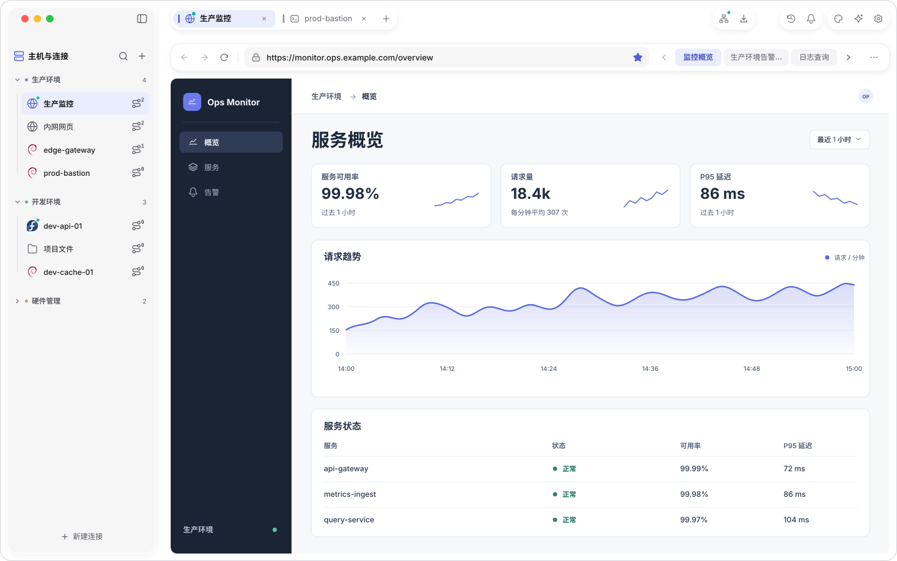
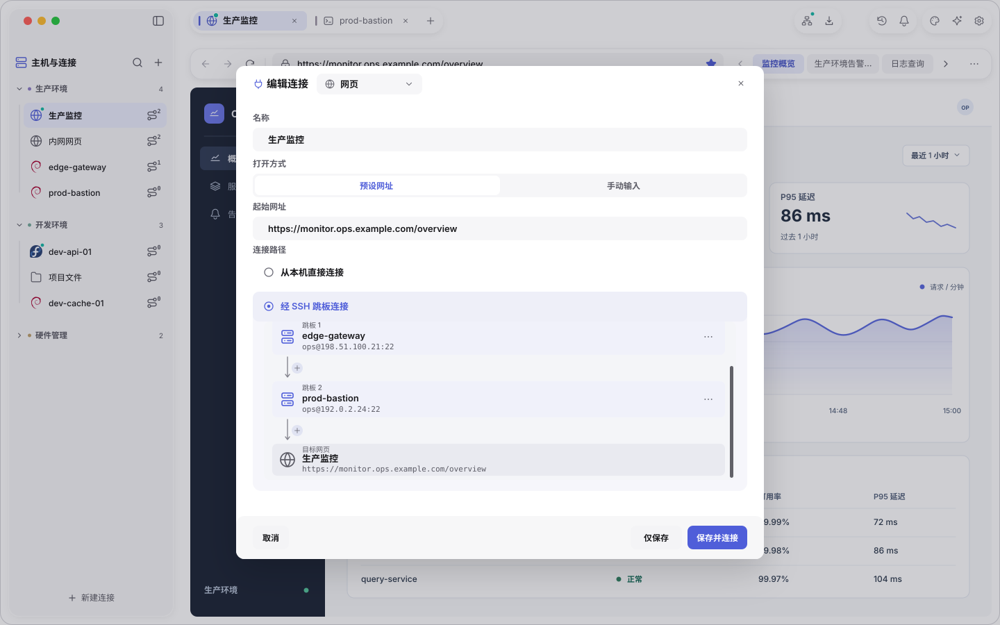

# V0.6 网页连接插件

> 本轮仅实施 V0.6.0 网页连接，V0.6.1「AI 浏览器交互」暂不实施，也不计入本轮验收。本文定义产品范围、技术接缝、可编辑 SVG 和验收要求。V0.6.0 内部使用阶段 A/B/C。

## 1. 目标与交付范围

增加与 SSH、SFTP、BMC 同级的内置浏览器连接插件（显示名「浏览器」，原「网页」），协议 ID 为 web，本质上是打开一个浏览器环境方便访问内网网址。资产进入「主机与连接」，打开后创建标准工作区页签，内容页由原生导航工具栏和 WKWebView 组成。支持预设网址或手动输入、直接连接或 1–8 跳 SSH 路径，以及每个连接最多 16 个书签。

网页经 SSH 访问非回环目标时使用本会话独立 transport 与本地 SOCKS5 代理，浏览器访问原始 HTTP(S) URL；回环目标保留本机语义，见 §5。已有终端的关闭、重连和转发操作不改变网页会话归属。平台采用系统 WebKit，新增代码包括插件逻辑、受限宿主接口和 Objective-C/C 桥接。

| V0.6 必要交付 | 完成行为 |
| --- | --- |
| 标准连接插件 | 保存、临时连接、编辑、重开、关闭与状态投影 |
| 两种网址模式 | 预设入口自动打开，手动模式提交网址或点击书签后访问 |
| 两种网络路径 | 本机网络直连、独立 SSH 单跳/多跳代理 |
| 网页浏览 | 导航、前进、后退、加载/停止、表单、Cookie、重定向、Fetch/XHR、WS/WSS |
| 书签 | 星标添加、编辑/移除、最多 16 项、单项限宽和横向滚动 |
| 原生集成 | 内容槽布局、焦点、输入法、宿主浮层、页签切换 |
| 资源收尾 | 取消、断线、重连、关闭、迟到回调和会话隔离 |

首版网站数据采用每页签、每次网页会话独立的非持久数据仓。网页登录在站点内完成，关闭或重建网页会话后重新登录；SSH 重连会新建 WebView 和数据仓，不迁移旧 Cookie、网站存储、未提交表单、滚动位置和前进后退历史。资产配置与书签保留。普通刷新、切换页签和显示宿主浮层不重建数据仓。持久登录、跨连接书签同步、通用浏览历史、浏览器扩展、独立网页弹窗和跨窗口拖拽留待独立需求。文件下载和网页文件选择上传可后续接入宿主文件流程，未实现时给出明确反馈。本版验收不以这些扩展或 AI 自动化为前提。

## 2. 配置与编辑

公共 ConnectionEnvelope 保存 id、name、group_id、protocol_id、revision、payload_version，web payload 保存下列字段。设计编号与 payload schema 版本分别管理。

| 字段 | 规则 |
| --- | --- |
| url_mode | preset 或 manual |
| start_url | preset 必填，manual 不保存。完整 HTTP(S) URL |
| route.mode | direct 或 ssh |
| route.hop_asset_ids | ssh 为 1–8 个有序 SSH 资产 ID，direct 为零项 |
| bookmarks | 有序数组，0–16 项。每项具有稳定 id、title、url |

「浏览器」追加到现有连接向导的协议选择。表单提供名称、打开方式和起始网址，连接路径共用 SSH／SFTP 向导的路径卡片和拓扑组件，目标节点显示网页名称和网址。切换为手动输入时隐藏起始网址，本次编辑草稿可保留输入以便切回，保存 manual 配置时清空该字段。直接连接隐藏跳板编辑，保存 direct 时清空路线引用。草稿不影响已运行会话。

URL 解析共用于编辑器、地址栏和书签。去除首尾空白，无 scheme 时补 https。接受有效域名、IP、IPv6、端口、路径、查询与 fragment，拒绝控制字符、userinfo、缺少 host 和非 HTTP(S) 顶层协议。校验失败指向具体字段。HTTPS 失败保留错误，由用户明确更改地址。

解析器校验有效 UTF-8、IDN、IPv6 方括号和 1–65535 端口，保留 percent-encoding 与路径/查询语义。离线校验不发 DNS 请求、不读取凭据。payload 只保存资产配置与书签，不写入当前导航地址、代理端口、运行句柄、Cookie 或网站密码。日志中的 URL 使用脱敏 origin，完整查询与 fragment 仅在需要的页面 UI 中呈现。

跳板列表复用现有 SSH 资产选择器、排序和删除操作，按显式顺序冻结配置。最后一个 SSH 节点是出口，网站不是 SSH 节点。沿用 resolver 的重复端点、引用失效、协议和上限校验，不递归展开所选资产内部保存的跳板链。SSH 凭据通过资产引用获取。

添加、排序或移除跳板只更新草稿。「仅保存」离线校验并持久化。「保存并连接」保存成功后创建新页签。「临时连接」创建同样的运行会话，配置及书签仅在该临时会话内保留。打开已保存的资产也走同一套启动规则，见 §3。保存失败保留草稿并反馈原因。

兼容早期实验数据时，将仅有 url 的记录按是否为空归一为 preset/manual，缺少 bookmarks 取空数组。未知 payload 版本保留原数据并报告不支持。仅在检测到已知版本的超限或损坏书签时，进入连接编辑器的「修复书签」异常流程，完整列出条目并定位无效字段；用户缩减到 16 项并修正字段后再保存，禁止静默截断。正常连接不显示修复或书签管理入口。修复期间不创建网页或建立 SSH，规则见 §4.4。

## 3. 网址与内容页

| 场景 | 行为 |
| --- | --- |
| 打开预设连接 | 将起始网址作为首次导航目标；直连立即加载，经 SSH 跳板则自动建链并启动本页签的转发，代理就绪后自动访问该网址 |
| 打开手动连接 | 显示空白内容页并聚焦地址栏；首次回车提交有效网址或打开书签时，按配置直连或自动建立 SSH 转发后访问 |
| 网站链接和重定向 | 在当前页签正常导航，地址栏显示实际到达地址 |
| 书签跳转 | 访问书签 URL，进入当前页签历史，资产起始 URL 保持原值 |
| 同一连接输入新网址 | 两种模式均可编辑地址栏，回车后在当前页签导航；已就绪时复用原路径和网站数据仓，建链中替换待打开网址，断线时按 §3.1 重连 |
| 切换页签 | 隐藏并停用原生视图输入，保留页面、登录、滚动位置和浏览历史 |
| SSH 重连 | 沿冻结路线新建网页会话，清空网站登录、未提交内容、滚动位置和历史；保留页签身份、资产配置与书签 |
| 重新打开资产 | preset 从起始 URL 开始，manual 从空白开始，保留显式保存的书签 |

工具栏依次为后退、前进、加载/停止、地址栏及其星标、书签、更多。建立 SSH 或加载网页期间，重新加载按钮切为停止；历史为空时禁用对应导航动作。更多提供复制网址和查看路径，preset 另有「回到起始网址」，窄窗时收纳可直接点击打开的书签列表，不设置「管理书签」。

点击地址栏可放置光标，⌘L 聚焦并选中完整地址。未编辑时显示当前导航地址，建链期间显示待打开网址。输入或粘贴只更新草稿，旧页面回调不能覆盖草稿；Esc 取消编辑并恢复当前显示地址，回车提交。无效网址保留草稿并在地址栏附近提示。编辑和提交都只作用于当前页签；要改下次自动打开的网址，在连接设置中编辑「起始网址」。

SSH 建链时显示「正在连接 SSH」和当前配置的跳板顺序，认证沿用宿主交互。逐跳连接和认证完成、会话专属 SOCKS5 监听就绪、代理绑定到本页签的 WebKit 数据仓后，自动加载待打开的原始 HTTP(S) URL，无需额外打开终端或启动转发。代理就绪后进入「正在加载网页」。建链失败保留目标和错误，非回环目标不回退为本机直连；代理仍在线时，网页加载失败可直接重试当前目标。回环目标按 §5 保留本机语义。

页签标题使用资产名，临时连接使用其创建名称。路径按钮显示实际跳板顺序与状态。站点内部标题、侧栏和仪表盘属于远端页面，原生插件只负责内容外围的交互。

用户触发的普通 GET 新窗口链接可在当前页签打开。依赖 opener、特殊弹窗或未实现文件能力的操作显示相应限制，不把未知请求转换成 GET。HTTP 错误响应保留网站页面，DNS、TLS、代理和内容进程错误由插件分别呈现。

controller 分别保存起始网址、当前已提交网址和待导航目标。首次自动导航在内容槽附着且对应网络已就绪后只决定一次，建链期间已有显式导航时优先最新目标。resize、主题切换、renderer update 和原生视图重新挂载均不再次打开起始网址。首次导航仅采用普通 GET，连接配置不保存待重放的表单请求。

### 3.1 重连与网页会话重置

SSH 断线立即撤销旧代的输入、开流权限与代理认证能力，保留错误页和恢复目标。断线页在操作前显示「重新连接将清除网页登录、未提交内容和浏览历史。」并提供「重新连接」「查看路径」。重连成功后的首次页面显示一次「连接已恢复，请重新登录网站。」；首次建链失败重试没有旧网站数据时，不显示数据丢失或重新登录提示。

所有重连入口共用这一流程，包括断线时点击书签、提交新地址和路径操作。已经显示本次断线影响提示后，用户的明确操作可直接继续；未显示提示的入口先定位断线页并保留目标，由用户点击「重新连接」执行，不在后台静默重置。取消建链保留书签和目标；一旦开始重建，旧网站数据不恢复，错误反馈不能声称已保留登录。

恢复导航优先采用用户本次明确输入的网址或所选书签；没有新目标时，只恢复当前文档已确认的普通 GET 地址。POST/表单结果页、请求方法或结果未知时，不把原 URL 转成 GET，也不回放旧请求；两种模式均可输入新网址或选择书签，preset 还可选择「回到起始网址」。新会话从空历史开始，网站可能重定向至登录页，登录后的业务恢复由网站负责。

普通页面加载失败的「重新加载」不重建 SSH 或数据仓；WebContent 退出后如果同一数据仓仍可使用，显式加载也不宣称网站数据已清空。确需重建 WebView 与数据仓时采用相同的重置提示及恢复规则。切换页签、显示浮层和临时 renderer unmount 仍保持原网页实例。

## 4. 书签

书签沿用浏览器操作：**左键单击直接打开，空心星收藏当前页，右键编辑或移除。** 书签条及窄窗列表中的单击、Enter 都执行导航，不先进入列表、表单或管理弹窗。日常界面不提供独立书签管理页，也不在连接配置中编辑正常书签。

### 4.1 容量与保存

**每个保存的网页连接最多 16 个书签，每个临时连接同样最多 16 个。** 同资产的多个活动页签共用该资产书签列表，各自保留浏览位置和书签滚动位置。

点击空心五角星直接添加当前已提交的有效 HTTP(S) URL。标题默认取页面标题，缺少标题时取域名。记录稳定书签 ID，初始顺序追加到末尾。新项目保存成功后显示实心星，不自动弹出编辑表单。点击实心星或书签项的右键「编辑书签…」才打开小型编辑浮层；移除由书签项右键菜单执行。空白页或连接错误页的添加动作禁用，不影响已有书签的右键操作。

书签 URL 使用统一解析结果去重。scheme/host 大小写与默认端口按解析器规范化，路径大小写、查询内容/顺序和 fragment 保留。重复收藏请求复用原项、不新增重复记录；点击书签本身始终导航，不能因已收藏而变成编辑。容量达到 16 时仍允许编辑和移除已有项。

第 16 项允许正常加入，第 17 个不同 URL 的新增请求返回「最多保存 16 个书签，请先移除一个」。该反馈靠近星标出现，原条目和当前页面继续可用。新增或移除均在持久化成功后更新星标和列表，保存失败保留原状态并允许重试。

所有页签通过同一资产写入入口，按最新 revision 原子完成去重、容量检查和更新。不能先按本地旧列表判断再盲写。并发两个窗口在剩余一个名额时，最多一个不同 URL 写入成功，另一个收到容量反馈。同 URL 并发新增合并为同一条。菜单动作按书签 ID 操作，避免重排后误删。

### 4.2 尺寸与滚动

| 区域 | 约束 |
| --- | --- |
| 书签区 | 位于 URL 右侧和更多左侧，按内容取宽，最大 328 逻辑点，包含滚动按钮 |
| 单个书签 | 74–104 逻辑点，最大宽度包含左右各 10 点内边距，正文单行末尾省略 |
| 书签按钮 | 高 28，间距 4，容器高 32 |
| 星标 | 地址栏内右端，16 点图标，28 × 28 命中区，URL 文本裁剪范围避让 |
| 左右滚动 | 溢出时出现箭头，支持触控板横滑，箭头一次滚到相邻项目，到边界禁用对应箭头 |

悬停或聚焦显示完整书签标题，编辑菜单可查看完整 URL。键盘 Tab 进入屏外项目时滚到可见位置，Enter 打开。滚动仅改变书签视口。没有书签时收起该区域。窄窗口先收缩书签区，为地址保留至少 132 点，再按需将书签转入「更多 → 书签」。

### 4.3 点击与网络状态

书签总在所属连接页签导航。手动模式未建链时，点击书签启动原配置路径，成功后访问该 URL。断线时点击书签按 §3.1 的重连提示和重置流程处理。认证或建链中新的显式导航替换待打开目标，只有最新目标在路径就绪后执行。路径失败保持目标与错误，不能改用本机直连访问。

### 4.4 右键编辑与异常修复

书签条和窄窗书签列表的每一项支持右键／键盘上下文菜单：「编辑书签…」「移除」。菜单按选中条目的稳定 ID 操作，与当前地址、星标、网络状态无关。A 重定向到 B 或 A 无法访问时，直接右键 A 即可修改或移除，不必先成功打开 A。右键只打开菜单，不触发导航。

「编辑书签…」在该条目附近打开小型浮层，仅含名称、网址、保存和取消。完整值可编辑／复制，长 URL 支持光标横向移动；校验定位具体字段，与另一条规范化 URL 相同则提示「该网址已在书签中」，保留草稿。保存按 §4.1 的最新 revision 原子提交，临时连接只改内存。外部修改同一项时保留草稿并提示，已删除项不复活；取消、Esc 或关闭浮层丢弃本次未保存编辑并返回书签。编辑与移除不导航、不发网络请求。普通连接配置保存必须保留最新书签，revision 冲突时保留草稿，不以旧 payload 覆盖。

修复视图只用于 §2 检出的超限／损坏数据，不进入日常书签操作。标题为「修复书签」，显示实际数量与字段错误；完整列出原条目，保留无效原始值供修正或移除。无法解析的条目保留原始内容并允许明确移除；缺失／重复 ID 用仅在本草稿有效的行标识定位，最终保存时为保留的条目分配有效唯一 ID。行内「应用」只更新修复草稿；总数不超过 16 且各项合法、无重复后才启用「应用修复」，返回连接编辑器后统一保存。取消或保存失败均保留磁盘原数据，不发网络请求。Tab／Enter／Esc 和列表滚动只服务于该异常修复流程。

## 5. 网络与平台

直接连接使用本机系统网络设置。SSH 模式下，localhost、127.0.0.1、::1 等回环目标仍指向运行 ZeroWork 的本机，不改为 SSH 出口机器。此规则适用于顶层导航、重定向后的目标和页面子资源；回环请求访问本机属于预期行为，不作为代理故障或开发、交付阻塞。

SSH 模式访问普通远端 IP、域名等非回环目标时，请求路径如下。本地 SOCKS5 监听地址与网页目标地址是两个不同用途的地址。

```text
WKWebView / 本页签 WebsiteDataStore
  → 127.0.0.1 的会话专属 SOCKS5 端口
  → 本页签 owned SSH transport
  → 有序跳板链的最终出口
  → 原始非回环 HTTP(S) 目标
```

代理在首次导航前配置到对应数据仓，对需要代理的非回环目标禁用直连回退。这些目标的域名通过 SOCKS5 交给出口解析，原 URL、Host、TLS SNI、Origin 和 Cookie 语义保持一致。内网域名、多域资源、重定向与 WS/WSS 必须通过测试站点验证。

独立 transport、监听器与数据仓由网页 owner 持有。复用现有 SOCKS 解析/转发机制，通过公共 transport 的 stream adapter 接入，避免直接依赖 SSH 插件内部指针。并发、队列、缓冲和超时遵循实际资源上限，开流不得阻塞 UI 线程。监听器以端口 0 绑定 loopback，由系统为当前会话分配空闲端口，端口不持久化。右上角转发入口打开当前网页会话的只读面板，从本会话代理读取实时状态；仅在监听可用时显示实际端口。重连后按新代理状态刷新，凭据仅供 WebKit 配置使用。同机其他进程可访问 loopback，临时端口不宣称为进程访问控制。每代代理必须使用独立的临时认证能力，具体约束见 §5.3；不沿用现有无认证 SOCKS 监听的放行规则。

SSH 断开后停止页面新操作并呈现错误，对需要代理的非回环目标保持禁用直连回退的配置。按 §3.1 重连时新建代次、代理凭证、WebView 和非持久数据仓，旧数据仓不绑定新代理。自有资源按 §6.4 的可观测条件收尾，旧请求由认证和代次校验阻断；不以等待 WebKit 网络进程退出作为正常回收前提。

WebKit 专用代理 API 从 macOS 14 可用。本轮网页连接以当前目标 macOS 系统为验收环境，不安排旧系统兼容性专项验收。系统 WebKit 不随安装包分发，最终用相同 ReleaseFast 和签名流程测量 App、DMG 与更新 ZIP 增量。[Apple 代理配置](https://developer.apple.com/documentation/webkit/wkwebsitedatastore/proxyconfigurations-6g21z)

SSH 模式的验收包括代理失败而本机仍可直达非回环目标的情况。针对非回环目标的 WebRTC/UDP 等潜在旁路，使用测试页核实平台行为，未经约束和验证的能力不对外声明支持。检查范围以本版实际加载的网页协议与 WebKit 可触发路径为依据。

### 5.1 转发适配与资源预算

代理 prepare 在配置所属线程冻结路由，start 只提交后台任务。SOCKS accept/poll 循环增量解析握手，先完成本代认证，再接受 CONNECT；BIND/UDP ASSOCIATE 返回不支持。ATYP domain 交给最终 SSH 出口，成功响应在目标 TCP 通道实际建立后发送。

现有 openTcpStream 会等待开流完成，因此使用有界开流队列与固定 worker，不能直接阻塞 UI 或代理主 poll。活动流上限沿用 transport_factory.max_streams，当前为 16。初始待开流队列最多 16、opener 最多 2，opening 计入待开流预算，成功后原子移入活动预算。未完成握手的连接也独立限流，握手/开流超时与双向缓冲采用现有服务的实际限制。每次失败、超时和取消都归还槽位，主线程通过 poll 推进收尾。[传输实现](../../src/host/transport_factory.zig)

OwnedStream、socketpair 与底层 SSH 通道分别遵循既有所有者约定，业务 controller 只持代理 token。重复 stop/cancel 幂等，半关闭按各方向 EOF 排空，错误保留可解释的 SOCKS reply 和脱敏原因。

### 5.2 出口与回环验证

准备本机与跳板出口可区分的测试服务，为每次请求分配无敏感内容的请求 ID。先发一个已知直连的对照请求，确认观测能识别来源，再验证非回环目标路径。分别检查普通 HTTP(S)、跨域子资源、重定向、Fetch/XHR、WS/WSS、DNS 预取以及系统实际支持的 worker，覆盖普通域名及非回环 IPv4、IPv6 地址，确认这些请求经过所选 SSH 出口。

localhost、127.0.0.1、::1 等回环目标单独验证：顶层导航与页面子资源访问运行 ZeroWork 的本机服务，按预期通过，不要求它们进入 SOCKS5 或 SSH。非回环 IPv6 地址仍遵循远端目标规则，不能将所有 IPv6 地址都视为本机访问。

记录实际 OS/SDK、SOCKS 目标类型、服务端来源与请求次数。断链测试使用原本经过代理、同时本机也能直达的非回环目标，保持本机网络可用，确认断开代理或 SSH 后目标没有收到本机直连请求。回环地址在代理停止后仍可访问，不能作为非回环请求发生直连回退的证据。代理端口启动或页面访问失败均不能替代出口证据。测试仅捕获夹具流量。非回环目标存在实际可触发旁路时，修复相应平台策略后再宣称该路径受代理约束。

### 5.3 代理代次隔离与端口复用

每个代理代次创建独立、不可预测的临时用户名／密码，密码至少含 128 bit 随机熵，仅交给本代数据仓的代理配置。凭证不使用网站或 SSH 秘密，不持久化、不进入 UI／日志。SOCKS5 仅接受用户名密码认证，拒绝无认证协商、缺失凭证和旧代凭证；认证成功后、提交开流前都复验本代仍可接纳请求。已认证连接也固定绑定原 owner/generation，禁止通过端口号或当前活动页签重新寻找 transport。

断线、取消或关闭先撤销代次与认证能力，再取消本代握手、排队开流、已建立的转发及监听。旧连接不能继续提交新开流；已提交的异步结果仅由原代次收尾。新代次使用新凭证，即使系统重新分配相同端口，旧数据仓的请求也必须在开流前被拒绝。因此旧监听关闭后无需为防止端口复用而永久保留拒绝连接的监听器。

使用公开代理凭证 API；API 的存在不等于 WKWebView 与 SOCKS5 认证已验证。阶段 A 必须在当前目标系统验证：正常认证、无认证拒绝、旧凭证拒绝、两数据仓隔离，以及人为复用旧端口后旧 WebView 迟到请求不会取得新凭证或打开新 transport 的流。若平台缓存凭证或协商行为破坏隔离，本阶段不通过，SSH 网页能力不进入后续交付；不得退回无认证、直连或无限保留旧监听。直连能力独立。[Apple 代理认证](https://developer.apple.com/documentation/network/proxyconfiguration/applycredential(username:password:))

## 6. 插件、平台视图与状态归属

| 模块边界 | 职责 |
| --- | --- |
| web 插件 | manifest、payload/codec、editor、session factory、controller、renderer、书签命令和样式 |
| 宿主能力 | 配置解析与凭据、owned proxy、受限 WebView surface、状态/关闭协调 |
| 平台桥接 | WKWebView、WebsiteDataStore、delegates、主线程 NSView 挂载与释放 |
| 既有工作区 | 协议选择器、侧栏、页签、助手入口、公共路径与通知投影 |

拟新增模块名称以实际源码为准。可复用边界包括 ConnectionEnvelope、ContentMount.owner、RendererInstance、SessionFactory、connection_config_resolver 和 transport_factory。新的平台 surface 能力应由宿主显式提供，不能把 WKWebView 或 NSWindow 原始指针交给业务插件。现有 socks_route_host 依赖 SSH owner，需适配网页自己的 transport。[配置模型](../../src/config/connection_envelope.zig) · [插件 UI 契约](../../src/host/plugin_ui_contract.zig) · [独立传输](../../src/host/transport_factory.zig)

Zenit 负责导航栏、地址输入、书签和状态页面，WKWebView 占内容槽。宿主同步实际窗口、矩形、裁剪、DPR、可见性与焦点。窗口缩放、侧栏折叠、页签切换与弹层覆盖都要更新原生视图状态。网页不能盖住宿主弹窗或截获其输入，必要时在覆盖期间隐藏并保留网页实例。原生 UI 的中文 IME、快捷键和文本选择分别验证。

路径状态与页面状态分开记录。路径为 idle、connecting、ready、disconnected、closing/closed，页面为空白、loading、displayed、failed。ready 的代理监听不代表页面加载成功。创建可先发布可呈现的内容服务，renderer 挂载后再按配置启动导航，避免等待首次页面加载才允许挂载的循环。

运行操作绑定 SessionHandle、generation、operation 与页面实例。切换活动页签不会重定向在途回调。重连沿用当前会话已冻结路线，用户重新打开资产时读取最新配置。编辑凭据或路径后需要明确重新打开才能应用。重连的网页登录重置及普通 GET 恢复按 §3.1 执行，表单/POST 及结果未知的动作不自动重放。

关闭先撤销新导航与输入，完成或取消 pending delegates，再卸载内容、停监听、收尾转发流与 SSH，最终发布真实资源回执。网页清理应纳入已有关闭协调，不能借用面向用户手动转发的步骤提前销毁网络上下文。

### 6.1 清单、服务与命令

沿既有插件 API 注册 web 的 connection、session_factory、workspace_kind 和 content_renderer。宿主提供的代理/平台能力写入 dependencies，由宿主发布并注入。插件自身提供的 lifecycle 和拟新增 web.page 服务才进入 services/required_services。

web.page 对 renderer 提供自有内存的 snapshot 与有界 command。快照包含 owner/revision、路径和页面状态、起始/当前网址、前进后退能力、加载进度、错误和书签 revision。命令包含导航、历史、加载/停止和书签操作，参数在受理时复制。相同 request_id 与参数幂等返回，不同参数复用 ID 报冲突。请求受理与实际页面效果分别记录，去重表有界。

ContentMount 中的 SessionServiceAccess 按当前 owner 查询服务，命令派发前复验 binding、generation 与 capability。快照和回调字符串不借用已结束的 UI 草稿或平台栈对象。release_stale 按完整 owner 与原 create operation 清理，不能只凭 session_id 关闭新代会话。poll 仅在实际变化时请求重绘。[服务访问](../../src/host/plugin_ui_contract.zig)

### 6.2 WebView 与内容槽

WebView 实例负责页面/网络，surface token 负责附着在指定窗口内容槽，两者生命周期分开。宿主以 WindowId、SessionHandle、renderer scope 与 generation 注册原生承载及 anchor，按布局后的实际矩形换算 AppKit 坐标、裁剪与 backing scale。禁止通过 keyWindow 或枚举系统窗口猜测承载位置，多窗口必须验证归属。

controller 是平台事件的唯一消费者，renderer 只读快照。事件携带 view generation、navigation_id 与单调序号。队列有界，进度和标题可以合并，挑战及终态必须得到处理。队列满时停止接纳新任务并返回明确失败，不能丢弃需要 completion 的请求。

原生输入由 AppKit/WebKit 处理一次，宿主在其前方检查窗口、内容归属、遮挡与控制权。隐藏、失焦和覆盖时撤销 responder 与 hit test。Modal、popover 和 tooltip 都进入层级验证，不能只验证大弹窗。原生指针保留在宿主/bridge，插件通过 token 操作。

### 6.3 回调、认证与对话框

桥接层持有 delegates、观察者和 Objective-C Blocks。导航策略、网站认证、JS alert/confirm/prompt 等每个待决回调都有唯一 pending ID，正常完成、取消、文档失效或关闭时恰好调用一次。晚到答复只收尾原请求，平台 callback context 在最后回调结束前保持有效，generation 校验不能替代内存生命周期管理。

JS 对话框进入所属窗口的统一队列，显示真实发起 origin。关闭时 confirm 返回否、prompt 返回取消，队列保持有界。网站 HTTP 认证使用当前 owner 的一次性挑战，秘密消费后清理。HTTPS 使用系统信任与域名校验，SSH 主机密钥批准不改变网站证书处理。HTTP 兼容性在正式 Info.plist 与支持系统上测试，确需 ATS 配置时限定到网页内容。

WebContent 进程终止只标记页面失败、撤销输入并结清该文档的 pending handlers。该通知不能证明网络进程已停止。普通 reload、导航错误和重建 SSH 会话分别处理，禁止自动重放未知完成的站点操作。

### 6.4 关闭前检查与回收

关闭风险快照必须在 SessionHost.close 撤销 typed bindings 前取得。沿宿主现有确认偏好与统一关闭入口处理，用户取消时保留文档和路径。原生关闭不承诺必然触发站点 beforeunload，也不凭加载状态声称检测到了未提交表单。

先禁止新命令并撤销输入，再结清 pending handlers、解除 surface、关闭本代流与 transport，最后发布各资源回执。临时 renderer unmount 只撤下显示，真实会话 close 才终结网络。创建取消与关闭复用逆序释放逻辑，回执保持原操作身份。

回收回执只证明本代宿主拥有的资源已释放与执行权已撤销，不宣称 WebKit 共享网络进程已退出或所有内部引用已消失。`stopLoading`、释放 WebView、短时无流量和 WebContent 终止均不能替代自有资源检查，也不要求用这些事件证明无法观测的系统内部状态。

| 自有资源 | 可进入 released 的条件 |
| --- | --- |
| 输入与代次 | 输入／导航／开流权限已撤销，原代次不可再次认证或接纳任务 |
| 回调与 surface | pending completion 恰好完成一次；surface、观察者和 delegates 已解除，宿主持有的 WebView／数据仓强引用已释放；正在执行或仍持有 callback context 的桥接任务已完成收尾 |
| 代理 | accept/poll 和 opener worker 已退出，监听 FD 已关闭，本代 accepted sockets、握手、排队／在途开流及转发流计数均为零 |
| SSH transport | 独立 transport 返回真实 released 回执；底层仍为 awaiting/unknown 时原样保留 |

各项均满足后发布该 owner/create operation 的 released 回执并移除回收记录，允许端口被系统重新分配。新监听仍强制 §5.3 的新代认证；可观测资源归零与旧请求无法进入新代共同构成终态，不依赖 WebKit 内部退出通知。直连会话的代理和 SSH 项记为不适用，只确认自有原生资源与执行权释放，不承诺撤回已发送到网站的请求。

只有确实未收尾的自有资源进入宿主有界回收队列，创建前预留预算，按具体未完成项保留 awaiting/unknown 并继续推进；超时不伪报 released。预算耗尽阻止新的网页会话创建／重建，并提示「连接仍在关闭，请稍后重试」，不阻止书签离线管理，不为正常关闭保留永久占用端口的墓碑监听，也不强制终止可能共享的 WebKit 进程。阶段 A 需以连续打开／关闭和断线／重连验证计数回到基线，注入实际清理失败验证预算与恢复。

<a id="probe-scope"></a>
### 6.5 连接测试的身份与边界

若提供连接测试入口，复用现有 ProbeToken、ProbeContext 与 EditorProbes。ProbeToken 持有宿主分配的真实 SessionHandle、子 operation、父 editor operation 与 draft_revision。测试不挂页签，不把 editor_id 转成 SessionId，不借用活动会话。配置更改后的结果仅作旧草稿诊断，编辑器销毁时取消所属测试并等待清理回执。[现有测试契约](../../src/host/probe_contract.zig)

SSH 模式只验证本次独立路径，直连模式使用本机网络。没有目标 URL 时仅报告路线验证范围，有 URL 时可用独立客户端验证 DNS/TCP/TLS 和 HEAD 响应，网络配置须与所选模式一致。405/501 表示站点不支持 HEAD，不自动 GET 任意路径或提交登录表单。测试不使用默认 Cookie，正常结果只在 cleanup released 后发布。测试是独立操作，不作为保存合法配置的必要条件。

## 7. SVG 基准与实施阶段

现行视觉基准集中保存在仓库根目录的 design/web-connection/。SVG 视口均为 1440 × 900，采用晴霜主题，地址栏高 32，网页工具栏高 44，正文从 y=126 起随内容区填充。SVG 只呈现最终产品内容；设计说明、行为契约和验证记录放在配套文档中。

| 图稿 | 对应行为 |
| --- | --- |
| [预设网址已打开](../../design/web-connection/preset-ready.svg) | 网页内容、可编辑的当前地址、已收藏星标和书签条 |
| [正在连接 SSH](../../design/web-connection/route-connecting.svg) | 预设网址等待自动打开，用户已聚焦地址栏，可更换本次打开的网址 |
| [查看网页转发](../../design/web-connection/route-status.svg) | 只读显示当前网页会话的实际监听端口、状态和跳板顺序 |
| [手动输入待打开](../../design/web-connection/manual-entry.svg) | 聚焦地址、空白页、已有书签和禁用星标 |
| [书签横向滚动](../../design/web-connection/bookmark-overflow.svg) | 未收藏星标、长标题省略和左右滚动 |
| [编辑预设网址](../../design/web-connection/editor-preset.svg) | 网页专属字段与起始网址 |
| [编辑手动输入](../../design/web-connection/editor-manual.svg) | 手动模式的网页专属字段 |
| [书签右键菜单](../../design/web-connection/bookmark-context-menu.svg) | 对所选书签编辑或移除；正常左键仍直接打开 |
| [编辑书签浮层](../../design/web-connection/bookmark-edit.svg) | 右键选择编辑后修改名称／网址 |
| [修复书签](../../design/web-connection/bookmark-repair.svg) | 仅损坏／超限数据触发的异常修复状态 |
| [SSH 转发断开](../../design/web-connection/route-disconnected.svg) | 错误归属、重连重置提示和路径详情 |

尺寸、状态和组件标识见 [SVG 配套说明](../UI_V4/web-connection.md)。





| 阶段 | 交付与验收 |
| --- | --- |
| A 原生与网络可行性 | 实际内容槽挂载 WKWebView，双跳代理、域名/TLS/子资源/WS、非回环目标断线无直连、回环目标访问本机、代次认证及端口复用隔离、自有资源回收终态、焦点和浮层 |
| B 插件与配置 | 标准注册、四种模式组合、离线保存、临时连接、重连重置与关闭、书签点击导航／原子写入／右键编辑／异常修复和 16 项限制 |
| C 界面与整体验收 | 对齐 SVG、星标与长标题、滚动/键盘、真实网页交互、多页签隔离与同条件包体测量 |

先完成必要接缝和可行性验证，再集成真实控件。阶段编号不改变应用或插件版本号，发布编号由独立发布任务决定。

## 8. 验收矩阵

以下功能在当前目标 macOS 系统验收，并记录实际 OS/SDK 信息。

| 用例 | 必须观察到的结果 |
| --- | --- |
| preset/manual × direct/ssh | 预设 SSH 打开页签即建链，代理就绪后自动访问起始网址；手动 SSH 在有效地址提交或书签导航后才建链；两种直连模式均不启动 SSH |
| 两种模式编辑地址 | 点击或 ⌘L 后可输入，Esc 撤销草稿，回车沿同一路径导航；建链中连续提交只打开最后一个有效目标；重开预设连接仍访问保存的起始网址 |
| 离线保存和临时连接 | 保存不发网络请求，临时书签随该会话结束，不污染保存资产 |
| 独立 SSH、多跳与 DNS | 无终端页签也能连接，非回环目标域名由出口解析，最后一跳与配置一致 |
| 查看转发状态 | 点击右上角转发入口，面板从当前网页会话读取实际状态；就绪端口对应本进程的 loopback 监听，断开后面板移除旧端口；直连显示「直接连接」 |
| 回环目标 | localhost、127.0.0.1、::1 等在顶层导航与页面子资源中访问运行 ZeroWork 的本机，属于预期行为 |
| HTTPS、表单、Cookie、跨域、WS | 保留站点语义，各请求遵循 §5 的回环／非回环路由规则，失败原因可区分 |
| 故障与回退 | 使用本机也能直达的非回环目标，断开代理或 SSH 后目标站无本机直连请求，重连不重放 POST；回环地址可达不算回退 |
| 重连重置与目标选择 | 已登录且存在表单草稿／历史的页面，所有重连入口先呈现影响；新数据仓无旧登录／存储、表单、历史和滚动位置，配置与书签保留；明确新目标优先，无新目标仅恢复确认的普通 GET，POST／未知页面不自动导航 |
| 刷新／隐藏与重置区分 | 普通刷新、切页签、浮层及临时 unmount 保持同一数据仓；首次建链重试不误报登录丢失，重建失败不声称原登录仍可恢复 |
| 星标与重复地址 | 新增成功变实心，再点可编辑，同 URL 重复添加仅保留一条 |
| 书签数量 0/1/15/16/17 | 0 收起书签区，16 正常保存，17 拒绝新增且原 16 项完整，删除一项后可新增 |
| 书签并发和写入失败 | 剩余一名额的两窗口竞态不超限，失败不虚显已收藏，菜单按稳定 ID 操作 |
| 点击与右键分离 | 左键／Enter 直接访问所选书签，不弹管理或编辑界面；右键不导航。A 重定向到 B、A 无法访问、空白／断线／窄窗／满额均能右键编辑或移除 A，维护操作零网络请求 |
| 编辑浮层与异常修复 | 浮层取消不写入，改 URL 冲突保留草稿，普通配置保存不覆盖新书签；正常数据不出现修复入口，17 项异常完整可见，合法后才可应用修复与保存，损坏 ID 不误操作其他项 |
| 长标题、滚动和窄窗 | 单项不超过 104 点、容器不超过 328 点，完整标题可读，滚动/焦点/菜单均可访问所有 16 项 |
| 通过书签建链 | 空白或断线状态按原路线建链后访问最后一次选择的 URL |
| 数据与身份隔离 | 同资产两页签共享书签，页面/Cookie/网络实例独立，关闭一个不影响另一个 |
| 输入与浮层 | 中文输入、快捷键、文本选择、缩放、侧栏及宿主弹窗均正常 |
| 取消、关闭与迟到回调 | 逐阶段取消无残留监听或错会话更新，未知清理如实保留 |
| 导航和回调一次性 | resize/切页签不重复首页请求，最新显式导航优先，取消/销毁不重复完成 pending handler |
| 有界资源与回收 | 握手、开流、活动流超限有明确回执；固定夹具连续 20 轮打开／关闭及 20 轮断线／重连后，每轮旧代自有监听、FD、worker、流、pending handler 与回收记录回到基线；实际清理失败保留对应回执，预算耗尽阻止新建，收尾后恢复 |
| 认证与端口复用 | 无认证／错误／旧代凭证零开流；强制新代绑定旧端口，旧 WebView 的迟到请求不能使用新凭证或进入新 transport；两数据仓认证不串用 |
| 连接测试（提供时） | 使用真实无页签 scope，旧草稿结果不覆盖新草稿，资源释放后报告结束 |
| 构建与包体 | 记录签名构建、App/DMG/ZIP 大小与开启网页前后内存，SVG 与实际原生截图匹配 |

当前验证覆盖生产构建、SSH／SFTP 向导回归、网页双跳原生端到端和独立 WebKit 代理探针。实际主应用验证了直连预设、手动输入远端 IP 经双跳访问、窄窗拓扑滚动、书签编辑、断线后恢复普通 GET 与正常退出。代理探针验证了远端 IPv4／域名走 SOCKS5、回环请求留在本机、代理故障时测试域名不回退直连。当前 WebKit 对本机网卡自身的 IPv4 也可能判定为本地，不能用它替代远端 IP 验收。

macOS 27.2.1 上新增的 5 项 HTTPS／WSS 检查验证了认证 SOCKS5 下的原始域名、TLS SNI、HTTP Host、WSS Origin 和消息收发。HTTPS 与 WSS 都拒绝域名不匹配的证书，生产默认信任拒绝未安装的测试 CA。TLS 探针使用受控 SOCKS5 夹具，真实双跳 SSH 由主应用端到端脚本验证。

同一系统上使用 Apple 简体拼音输入真实按键，验证连接名称和网页表单各提交一次「中文」。点击网页输入框时清除原生地址栏焦点。⌘L 回到地址栏后可组字，Esc 取消时网页输入值保留。复测步骤见 [端到端测试说明](../../e2e/README.md)。

本机测试构建在同一手动直连页签打开本地测试页前后，ZeroWork 进程的五次稳定 RSS 采样中位数为 233.0 MiB 和 230.3 MiB。打开页面后出现三个 WebKit 进程，其 RSS 合计 58.6 MiB，退出夹具应用后均消失。各进程的 RSS 可能重复计入共享页。

V0.6.1 的独立设计见 [AI 浏览器交互](V0.6.1_WEB_AI_CONTROL.md)。

## 9. 文件能力后续接入约束

文件上传下载属于第 1 节所列后续能力，以下约束供该能力进入实施范围时复用。

- 下载由当前 WebKit 下载对象继续执行，保留 Cookie、认证、原请求及代理上下文。POST 导出只发送原请求一次，blob 保留引擎对象引用，不从字符串 URL 重建。下载出口、重定向和断链回退需要单独验证。
- 宿主保存对话框决定目的地，文件名建议去除路径穿越和控制字符。写入同卷独占临时目录内的新 staging 文件，完成后再次检查目标冲突并提交，提交成功才标记完成。取消或失败只清理自己创建的临时文件，既有目标文件保留。进度来自实际下载回执，未知长度不编造百分比。
- 下载接入通用传输管理器的外部 producer 能力。关闭前按已有任务风险协调等待、取消任务或返回，清理终态前保持 callback context。引擎返回 resumeData 不自动构成断点续传承诺。
- 文件上传由网页 file input 调起宿主系统选择器，只向原始 WebKit completion 交付用户所选文件。结果绑定 owner、view generation、pending ID 和当次文档，导航、frame 失效或关闭时取消，晚到结果不得投递给新页面。路径与文件内容不进入插件配置、诊断或 AI 上下文。
- 文件选择仅证明用户已选择，上传进度与业务结果由网站负责。上传 POST/分片与断链分别验证，不能依据选择器完成就发布上传成功，也不能自动重发结果未知的请求。原生关闭仍沿第 6.4 节处理真实可知的风险。
